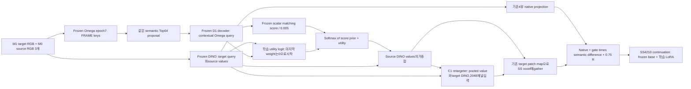

# Frozen matcher와 utility attention 후속 실험

## 첫8개 구조의 실제 고정 결과

동일 DeformNeXt128개·93source·3개 생성 noise,각480update/5epoch의 결과다. V1은 IoU43.2650%,matched Top1+C1은44.2757%,기존 C1 T0.005는44.2193%,static-C1 T0.05는44.0938%,learned Full은43.9236%,native-spatial은44.1701%였다. 실제 `candidate-selection-v1.json`은 `NO_PROMISING_COMBINATION_YET`이며6개 Top-K 후보 모두 같은 retargeter의 Top1 대조 기준을 통과하지 못했다. 모델을 채택하지 않는다.

Static-C1−Top1+C1은 −0.182pp,95% source-cluster CI[−0.308,−0.079]pp,Full−Top1+C1은 −0.352pp,[−0.624,−0.127]pp였다. 기존 C1−Top1+C1은 −0.056pp,[−0.131,+0.007]pp로 추가 이득이 확인되지 않았다. Retargeter를 더한 Top1+C1−Top1은 +0.823pp,[+0.427,+1.222]pp였다. 이 결과는 retargeter가 없는 Top1을 대조군으로 쓰면 Top-K의 효과를 잘못 읽을 수 있음을 보여준다. 모든 CI는 한 training seed에 조건부인 탐색 결과다.

실제 고정128의 feature 진단에서는 decoder/score 공동 학습으로 prior 실효K가4.67에서10.66으로 늘고,argmax가45.32% query에서 바뀌었다. 이는 정확도 하락의 증거나 SS 성능 차이의 확정 원인이 아니다. Frozen R9의 정보와 초기 가중합을 유지한 상태에서 생성용 utility만 학습하는 분리가 아직 검증되지 않았으므로,다음 단일 모델로 이를 검사한다. 첫 round의 보고서·선정 결과·모델·평가를 덮어쓰거나 기준을 완화하지 않는다.

## 후속 모델 F1

Frozen Omega epoch7과R9 D1 decoder/scalar head를 유지한다. 같은 semantic64 후보에서 `frozen_score/0.005 + utility_logit`으로 가중치를 구한다. Utility query는 native target DINO와 frozen contextual Omega, key/value는 원래 source DINO다. Query/key의128차원 projection으로 만든 elementwise product·절대차256차원에서 작은 scalar logit을 예측하며,마지막 linear weight를0으로 초기화한다. 초기에는 frozen matching prior만 읽고,SS 생성 loss로 utility output과 이어지는 query/key projection을 학습한다. Candidate value 자체를 바꾸는 projection은 추가하지 않는다.

C1 retargeter·fusion gate·denoiser LoRA는 같은 조건으로 학습한다. Deformation-query channel은 물리적으로 없고 retargeter 입력은2048차원이다. 기존 task 설정의`decoder`/`score_prior`는 forward 경로 존재 여부로 유지하고,새`train_decoder=false`/`train_score=false`가 학습 여부를 명시한다. 이전 Full·No-decoder·No-prior의 기본 동작과 checkpoint key는 그대로 유지한다.

현재 F1의 데이터 흐름은 아래와 같다. 구현된 후보 구조이며 최종 full model로 선정한 것은 아니다. Decoder/score는 frozen 상태로 forward에 참여하고,utility와C1 retargeter·fusion gate·SS LoRA가 학습된다.

사용자 SS4210에서 fresh seed101,global96/DDP2/micro48/accumulation1,5epoch/480update로 시작한다. 기존 native LoRA continuation·데이터·optimizer/LR·warmup25·validation32/12steps/CFG3·final128×3/생성batch8 조건을 유지한다. 기존 DeformNeXt world-v4 train9149/validation508과 RGB/Omega/DINO/proposal/projection cache를 재사용하며 새 raw/depth/matching 데이터 구축은 없다. GPU2/3의 이미 실행 중인 No-retargeter Top1 seed202는 유지하고 F1은 GPU0/1을 사용한다.

초기 native condition의 exact equality,실제 SS loss의 LoRA·fusion·retargeter gradient,temporary restored probe의 utility gradient와 matching decoder/score gradient0을 검사한다. DDP 두 update memory probe에서 micro48/accumulation1·각rank batch/유한 loss를 확인하고 benchmark optimizer를 재사용하지 않는다. 예상 optimizer state는371개(LoRA360+C1의6+utility5)이며 실제 값과 frozen matcher24개 tensor를 따로 검사한다. 매epoch validation/W&B 수치·그림,실제 raw checkpoint·optimizer·file4 대조를 유지한다.

## 판정과 후속 범위

원래 raw480/fixed128×3에서 V1과 같은 retargeter의 Top1 대비 paired source-cluster CI가 양수이고3noise 모두 같은 개선 방향이어야 개선 후보로 인정한다. 기존 C1 및 No-retargeter Top1 대비 결과도 함께 보고한다. Best epoch를 고르거나 initial/native equality 및 gradient 통과를 품질 개선으로 간주하지 않는다.

F1이 통과하면 fresh seed202 F1과 matched Top1+C1 seed202를 병렬 학습해 Top-K utility의 추가 효과도 두 optimization seed에서 검증한다. 이미 진행 중인 No-retargeter Top1 seed202는 전체 조합의 추가 기준선으로 재사용한다. 그 뒤 원래 예약한source-disjoint additional121/39source에서 고정 모델과 기준선을 비교하며,이 validation panel을 독립 미사용 test라고 부르거나 결과로 후보를 다시 고르지 않는다. 현재는 CPU 경로 검사61개를 통과한 구현 단계이며,실제 GPU 정합·memory proof·F1 본 학습·성능 향상은 아직 완료되지 않았다.

## 실제 시작 검사: 2026-10-19 UTC

위 구현 시점 이후 실제 GPU 정합·DDP memory proof를 통과했다. 실제 sample의 초기 global/projection condition은 native와 exact equality였고,LoRA/fusion/retargeter gradient는 양수,decoder/score gradient는0이었다. 원상복원하는 임시 probe에서 utility gradient도 확인했다. 실제2update DDP에서 두 rank 모두 micro48/global96/accumulation1·유한 loss를 확인했고,최대 allocated memory는50.464/50.336GiB,두 번째 update 계산 시간은17.263/17.295초였다. 이는 본 학습 전체의 OOM 보장이 아니다.

2update saved conditioner의24개 decoder/score tensor가 실제 R9 initializer와 정확히 같았다. Adam state371개가 모두 step2·유한 moment였고,zero-initialized utility output의256개 weight가 모두 갱신됐다(L2 norm 약1.321e-5). Retargeter 입력도2048채널로 확인했다. 이 benchmark optimizer는 본 학습에 재사용하지 않았다. 본 학습은 원래 SS4210에서 새로 시작해 초기 validation을 수행 중이며,이 기록 시점에는 본 SGD나 품질 개선을 완료했다고 주장하지 않는다.

첫 launch에서는 생성한 실행 recipe의 `ckpt`/`load_dir`가 JSON null이어서 memory benchmark가 optimizer update 전에 종료됐다. 실패 config·native proof·launch log·queue 상태를 `launch-attempts/attempt01-null-resume-option/`에 보존했다. 기존 runtime이 요구하는 `ckpt="none"`, `load_dir=""` 문자열로 수정하고 해당5개 job만 재개했다. 이미 학습 중인 Top1 seed202 process는 유지했고,scheduler만 정상 종료·재개해 동일 PID의 학습을 이어갔다. 잘못된 fresh 옵션을 모델 로딩 전에 거부하는 검사도 추가했다.

`summarize_frozen_utility_followup.py`는5epoch·실제 W&B 그림/수치·file4 audit bytes·saved tensor/optimizer·GPU conditioning 검사와 fixed raw480/128×3을 모두 확인한 후 V1/같은 retargeter Top1/retargeter 없는 Top1을 비교한다. 판정 결과가 양수여도 모델 채택은false이며 추가 seed/121개 검증이 필요하다. 새로운 실패 거부 검사11개가 통과했다. 이11개 unit test는 실제 모델 품질 근거로 사용하지 않는다.

00:15 UTC에는 본 학습 두 rank가 실제3update를 완료했다. 초기 validation32에서 V1·기존 C1·matched Top1+C1의 초기32개와 각 asset의 GT voxel hash·noise·source ID·TP/FP/FN 및 네 aggregate metric이 모두 같았다(IoU0.42671546671444294). 본 학습의 첫 update는 data-worker 시작으로 약43초 loading과83~85초 compute,두 번째는39.3초,세 번째는17.28~17.29초 compute였다. Benchmark 수치를 그대로 본 학습 속도라고 부르지 않고 실제 startup과 이후 구간을 구분한다. 이 시점 peak allocated memory는 두 rank50.464/50.510GiB이고 OOM·비정상 loss는 관측되지 않았다. 전체480update 품질 판정은 아직 남아 있다.

추가 seed의 matched Top1+C1 대조군은 F1의 결과를 기다리기 전에 예약했다. 현재 GPU2/3에서 진행 중인 No-retargeter Top1 seed202의3개 최종 noise 평가와 saved-weight QA가 끝난 뒤,같은 GPU2/3에서 fresh SS4210/seed202/global96/micro48/DDP2/480update로 시작한다. 원래 최고 대조군의 재현성을 검사하는 목적도 있어 F1이 음성이어도 유효하다. F1을 미리 선정하거나 학습 중인 run을 바꾸지 않았다. F1이 통과하면 그 seed202 학습은 나머지 GPU에서 병행하고 이 대조 결과를 재사용한다.

## 첫 학습 경로 확인: 00:29 UTC

F1 두 rank가51update를 완료했다. 실제 SS loss의 utility-attention gradient L1은 두 rank 모두0.0005894062601345951,decoder/score gradient는 모두0이었다. Fusion gate는0.003604,retarget residual RMS는 약0.00657/0.00679였다. 초기 step1의 utility gradient0 이후 실제 학습 신호가 흐르는 것을 확인한 것이며,품질 기여로 해석하지 않는다. 현재 batch의 effectiveK는1.228/1.212로 frozen T0.005의 강한 prior를 유지하는 구간이다. 서로 다른 batch의 수치를 직접 학습 전후 분포 변화로 해석하지 않는다.

No-retargeter Top1 seed202는 첫 epoch의 실제 W&B 네 수치·PNG 및 optimizer361개·raw checkpoint/file4 대조를 통과했다. Common32/한 noise의 IoU는0.435216로 seed101의 같은 epoch0.435134와 비슷했다. 두 run 차이는+0.008pp,source-cluster CI[−0.212,+0.255]pp였다. 이 CI는 두 고정 run의 source-panel 차이에 대한 것이며 training-seed 모집단의 불확실성을 추정하지 않는다. 추가 seed의 최종5epoch 결과와 F1 첫 epoch·최종128×3 품질 판정은 남아 있다.

## 실제 F1 첫 에폭

F1의 첫96update·validation·실제 W&B 네 수치와PNG·optimizer371개 및 raw checkpoint/file4 대조가 통과했다. Saved conditioner의24개 decoder/score tensor는 초기 R9와 정확히 같았고,utility의5개 parameter는 모두 갱신됐다. Output weight의 L2 변화는0.015699,query/context/key projection은 각각0.019743/0.029429/0.037850이었다. 원래 native 시작 출력이 같은 상태에서 새 utility가 실제로 학습된 근거이며,그 품질 기여는 별도 비교가 필요하다.

| 같은32개·noise0 | IoU |
| --- | ---: |
| Zero source4M0 | 0.394997 |
| Zero edited1M1+source3M0 | 0.426715 |
| V1,epoch1 | 0.432148 |
| 기존 frozen C1 T0.005,epoch1 | 0.436335 |
| Matched Top1+C1,epoch1 | 0.437187 |
| Joint-trained Full,epoch1 | 0.438333 |
| 새 F1,epoch1 | 0.436888 |

F1−matched Top1+C1은 −0.030pp,95% source-cluster CI[−0.154,+0.072]pp였다. 기존 C1 대비 +0.055pp,[−0.018,+0.132]pp,V1 대비 +0.474pp,[−0.533,+1.372]pp,Joint-trained Full 대비 −0.144pp,[−0.332,+0.010]pp였다. 네 대조 모두0을 포함했다. Zero edited RGB 대비 +1.017pp,[−0.597,+2.569]pp,source4M0 대비 +4.189pp,[+1.120,+7.587]pp였다. 모두 common32·단일 sampling noise·고정 training seed101의 중간 비교다. 첫 에폭 결과로 모델을 채택하거나 중단하지 않고 raw480/fixed128×3 기준을 유지한다.

최종 보고서에도 두 zero-shot의 기존128×3 실제 평가를 재사용한다. Source-only는4M0 RGB,edited-RGB는1M1+3M0 RGB이며 둘 다 같은 M1 GT에 대해 평가한다. 실제 기존 Top1+C1의 zero-shot 대비 세 noise paired 결과를 그대로 재현하는 reporting preflight가 통과했다. 이를 새 F1의 최종 성능 결과로 혼동하지 않는다.

학습 후에는 동일 raw480 모델의 common32/noise0에서 score·attention weight·candidate support와 각 query의 source-value multiset을 유지하고,value-to-weight pairing만 바꾸는 진단을 추가한다. 이는 원래 spatial matching을 사용하는 사용자 No-corr 학습 arm과 구분한다. 새 residual-zero utility의 초기 및 nonzero output 상태에서 logits·weights·입력 보존,pooled value 변경,hook 원상복원 검사2개가 통과했다. 이 진단은 모델 품질 선정이나 semantic retrieval 전체의 필요성을 단독 판정하는 기준이 아니다.

## 첫 에폭의 실제 optimizer 정규화

실제 misc step96의 conditioner Adam group은 LR1e-4,betas(0.9,0.95),eps1e-8이었다. `BasicTrainer`가 trainable `model.parameters()` 순서로 group을 만드는 것을 확인하고,같은 constructor의11개 trainable parameter와 저장된 optimizer state의 shape를 모두 대조했다. 아래 RMS는 raw gradient 한 번의 값이 아니라 bias-corrected second moment의 제곱근이다.

| Parameter | Median gradient RMS | eps보다 작은 성분 | Median RMS/(RMS+eps) |
| --- | ---: | ---: | ---: |
| Utility query projection | 7.15e-10 | 99.60% | 0.0667 |
| Utility Omega-context projection | 1.41e-9 | 99.46% | 0.1237 |
| Utility key projection | 2.14e-9 | 98.87% | 0.1764 |
| Utility output weight | 2.20e-6 | 0% | 0.9955 |
| Retargeter first weight | 6.42e-7 | 0.068% | 0.9847 |

즉 현재 query/key projection은 gradient 연결과 FP32 parameter 변화가 있으면서도 Adam 분모의 epsilon으로 업데이트가 크게 줄어드는 구간이다. 출력 head와 retargeter에는 같은 정도의 감쇠가 없다. 마지막 열은 현재 moment를 고정한 채 epsilon이 없는 분모와 비교한 산술 계수이며,다른 epsilon으로 재학습한 결과를 뜻하지 않는다. 이를 성능 부진의 확정 원인이나 epsilon 변경의 개선 증거로 해석하지 않는다.

현재 학습을 변경하지 않고 후반 checkpoint의 moment·utility 변화·실제 품질을 확인한다. 최종 성능이 부족하고 이 감쇠가 지속된다면,utility만 별도 Adam epsilon을 사용하는 통제 실험을 검토할 수 있다. LoRA와 retargeter까지 함께 바꾸는 실험으로 utility 학습의 효과를 혼동하지 않도록 한다. 같은 target patch의 voxel 공유와 native context 차이 진단도 별도의 설계 가설로 유지한다.

재사용 가능한 `inspect_utility_optimizer.py`로 실제 step96을 재검사해11개 parameter 통계를 기존 진단과 재현했다. 이 inspector는 실제 config/misc와 group 구성 source의 SHA를 함께 기록하고,371개 optimizer state의 step·유한값 및11개 대응 shape를 확인한다. Step288과480의 실제 epoch/file4 대조가 완료되면 같은 방법으로 기록하도록 예약하며,학습 optimizer나 GPU에 변경을 가하지 않는다.

## Utility 전용 epsilon 옵션의 준비 범위

`trainer.args.task_attention_optimizer_eps`를 명시하면 기존 conditioner optimizer group에서 실제 `task_attention` parameter만 분리한다. 예를 들어 `1e-10`이면 LoRA와 retargeter는 기존 `eps=1e-8`을 유지하고 utility group에만 `eps=1e-10`을 적용한다. Learning rate, warmup, parameter identity와 frozen parameter 제외는 보존한다. 기본값 `None`에서는 기존 두 group 구성 경로를 그대로 사용한다. 기존 `inflat_all`의 model별 learning-rate 제한도 유지한다.

신규 CPU 검사17개가 각각 통과했다. 실제 `BasicTrainer.init_models_and_more`의 FP32/BF16 AMP 설정, utility만 달라지는 작은-gradient Adam update, 기본 경로, 잘못된 group/epsilon 거부, 세 group optimizer와 warmup의 저장·복원 후 동일 update를 확인했다. GPU/DDP에서 이 옵션을 사용한 학습이나 성능 개선은 아직 검증하지 않았다.

이 변경은 현재 F1 학습이 시작된 이후의 공통 trainer에 추가한 선택 옵션이다. 현재 F1 프로세스는 변경 전 trainer를 이미 로드했고, config에 이 옵션이 없으며 저장된 실제 optimizer는 기존 두 group이다. 현재 reference F1 entrypoint는 이 옵션을 거부한다. 따라서 후속 실험은 명시적인 별도 profile, 실제 초기 native parity와 DDP micro48 메모리 검증, 세 group의 실제 epsilon·LR·저장 상태를 검사하는 별도 auditor가 준비된 뒤 실행해야 한다. 현재 단일 conditioner group을 전제로 하는 optimizer inspector를 세 group 실험에 그대로 적용하지 않는다.

현재 두 학습을 재시작하거나 optimizer를 중간 변경하지 않는다. 후반 moment와 고정 최종 성능을 근거로 이 통제 실험의 필요성을 판단한다. 낮은 epsilon이 품질을 높인다는 결과는 아직 없다.

## 실제 2에폭 중간 결과

Step192의 실제 checkpoint/optimizer, 두 rank의 micro48·accumulation1 기록, W&B 네 metric과 PNG, file4 저장본 대조가 완료됐다. Common32의 F1 IoU는0.441871이었다. 동일 에폭의 matched Top1+C1은0.440365,기존 C1은0.440602,기존 joint-trained Full은0.440274,V1은0.434444였다. 두 zero-shot의 같은32개 결과는 source4M0가0.394997,edited1M1+3M0가0.426715이다.

| F1 대비 기준 | IoU 차이,pp | 95% source-cluster CI,pp |
| --- | ---: | --- |
| Matched Top1+C1 | +0.151 | [−0.026,+0.388] |
| 기존 C1 | +0.127 | [−0.004,+0.330] |
| Joint-trained Full | +0.160 | [−0.032,+0.357] |
| V1 | +0.743 | [−0.421,+1.973] |

1에폭에서는 Top1+C1보다−0.030pp였고2에폭에는 평균이 앞섰지만,아직 위 네 대조의 CI가 모두0을 포함한다. 32개 샘플·단일 생성 noise·training seed101의 중간 결과로 개선을 확정하지 않는다. 고정 raw480/final128×3 평가 및 학습 seed 재현 기준은 유지한다. 비교 source는 `compare_frozen_utility_epochs.py`,실제 결과는 외부 campaign의 `frozen-utility-followup-v1/early-progress-v1/epoch02-common32-with-zero-comparison-v1.json`에 기록했다.

## 최종 결과에 따른 재현 분기

`frozen_utility_confirmation.py`는 실제 file4 대조를 마친 최종 결정과 원본 입력 hash를 확인한다. Raw480/final128×3에서 V1·no-retargeter Top1·같은 retargeter의 Top1 대비 각각 CI 하한이 양수이고 모든 생성 noise에서 이득이 있을 때만,원래 SS4210에서 fresh training seed202의 F1을 추가한다. 실패하면 음성 결과를 보존하고 재현 학습을 추가하지 않는다. 중간 epoch 성적이나 단순 point estimate로 이 분기를 열지 않는다.

재현 학습은 GPU0,1을 사용하고 기존 seed202의 두 Top1 대조와 비교한다. 기존과 동일한5에폭/global96/micro48/accumulation1,matching head 고정,utility/R/LoRA optimizer 설정을 유지하며,별도 port30443과 W&B run을 사용한다. 새 프로세스도 실제 native parity와 DDP micro48 메모리 검증을 먼저 통과해야 한다. 다섯 epoch의 실제 optimizer/W&B/file4 기록,최종 tensor와 GPU 조건 검증을 요구한다. 같은 retargeter의 Top1 대비 효과를 두 training seed에서 비교하며,여러 생성 noise를 독립 학습으로 세지 않는다. 별도로 예약한121개 source-disjoint validation은 아직 열지 않는다.

두 대조의 실제 seed202 config에 대해 model·optimizer·데이터·평가 정합 검사가 통과했다. 허용한 데이터 차이는 utility에 필요한 Omega context cache와 각 arm의 `transport_arm` consumer이다. Top1+C1 config의 `score_temperature=.05`는 raw-logit argmax 경로에서 사용되지 않으므로,현재 F1의 `.005`와 차이가 있어도 Top1 예측을 바꾸지 않는다. 실제 conditioner의 online/cached 경로에서 nonzero retargeter 상태로 두 온도의 correspondence·weight·evidence·residual이 정확히 같음을 CPU 검사로 확인했다. 원래 semantic correspondence 기본값도 동일하다. 이는 실행 중이거나 예약된 대조 config를 수정한 것이 아니다.

이번 조건부 분기의 CPU queue/quality 검사와 실제 config preflight는 완료했지만,seed202 F1 학습을 이미 실행했다는 뜻은 아니다. Decoder·score·correspondence 각각의 품질 기여도 확정하지 않는다. 최종 후보가 우수하면 그 후보에 맞춘 제거 실험과 value-address 진단을 해석하고,개별 모듈 효과가 없는 경우 전체 조합의 효과와 구분해 기록한다.

후속 검토에서 재현 요약 코드가 모든 arm에 학습형 QA status를 요구하는 문제를 수정했다. 실제 정적 Top1+C1은 `PASS_CURRENT_C1_CACHE_AMP_CFG_CONTRACT`,학습형 utility와 B2 Top1은 `PASS_TRAINED_SS_CACHE_AMP_CFG_CONTRACT`를 사용한다. 이미 검증된 recipe별 QA validator를 재사용해 실제 네 RGB 입력·CFG·두 사례 조건을 함께 확인한다. 두 대조의 실제 완료된 seed101 QA와 예약된 seed202 recipe에 대한 schema preflight,관련 기존 CPU 검사3개가 통과했다. 이는 앞선 config/hash 정합 preflight에 빠져 있던 status 분기 검사이며,현재 학습·checkpoint·성능 수치를 바꾼 수정이 아니다.

## 별도 W&B development 비교 리포트

`frozen_utility_wandb.py`는 실제 최종 결정의 file4 저장본 및 입력 hash,원본128×3 voxel count,동일 GT pixel과 noise를 확인한 뒤에만 별도 run `ss-frozen-utility-development-v1`을 만든다. 두 zero-shot·V1·Top1·기존 C1·Top1+C1·기존 Full·native spatial·새 F1의9개 모델 수치와 동일 사례 이미지를 기록한다. 새 추론이나 추가 학습을 수행하지 않고,기존 평가 순서의128개를 모두 PDF에 넣으며 PNG는 첫8개를 표시한다.

Final128의 IoU/F1와 paired CI,common32의 epoch curve,common32의 value-address 진단은 각각 다른 이름으로 기록한다. 최종 수치와 진단을 섞지 않고 음수 CI도 보존한다. 모델 weight는 업로드하지 않는다. 공통 publication/readback 코드는 별도 folder·run ID를 받을 수 있도록 확장했고,기존 campaign의 기본 경로·ID는 유지한다. SDK routing·scope·기존 publication 검사34개가 통과했으며,실제 완료된 firstwave reference 데이터128개로 공통 renderer의16-page PDF와 첫8개 PNG를 생성·확인했다. 이 renderer QA에는 새 F1 최종 성능이 포함되지 않는다.

실제 F1 고정 최종 평가와 value-address 진단이 준비되면 render→publish→독립 readback 순서로 실행한다. 새 빈 download cache에서 숫자·table·PNG·artifact byte를 확인한다. 이 리포트는 training seed101의 development 결과만 다루며,성공·실패와 무관하게 seed202·예약121개·모듈별 품질 기여·최종 모델 채택을 완료로 표시하지 않는다. 현재 이 별도 W&B 업로드 및 실제 원격 readback은 아직 실행 전이다.

## 실제 3에폭 결과와 optimizer 변화

Step288의 실제 checkpoint·371개 optimizer state·두 rank micro48/accumulation1·W&B 네 metric/PNG·file4 대조가 완료됐다. 후속 CPU 비교와 실제 Adam moment 검사도 실행했고,moment가 읽은 misc288의 SHA/크기를 해당 epoch의 실제 file4 receipt와 다시 대조했다. `epoch03-observation-v1.json` 및 `epoch03-optimizer-file4.json`에 기록했다.

| 같은32개·단일 생성 noise의 모델 | IoU |
| --- | ---: |
| Zero source4M0 | 0.394997 |
| Zero edited1M1+3M0 | 0.426715 |
| V1,epoch3 | 0.431872 |
| Matched Top1+C1,epoch3 | 0.441788 |
| 기존 C1,epoch3 | 0.443624 |
| Joint-trained Full,epoch3 | 0.441403 |
| 새 F1,epoch3 | 0.443527 |

F1−matched Top1+C1은 **+0.174pp,[+0.057,+0.295]pp**였다. 다만 기존 C1 대비는−0.010pp,[−0.084,+0.065]pp로 차이가 없었다. V1 대비+1.166pp,[−0.049,+2.647]pp,Joint-trained Full 대비+0.212pp,[−0.172,+0.579]pp였다. F1의 epoch2→3 변화도+0.166pp,[−0.288,+0.716]pp였다. 중간32개·단일 sampling noise·training seed101의 탐색적 관찰이며,여러 epoch를 확인한 결과다. 이번 Top1 우위를 최종 raw480/final128×3 선정이나 학습 seed 재현으로 해석하지 않는다. 학습 가능한 utility가 기존 고정 Top-K C1을 개선했다는 증거도 아직 없다.

| Parameter | Median RMS/(RMS+eps),step96 | step288 |
| --- | ---: | ---: |
| Utility query projection | 0.0667 | 0.3814 |
| Utility Omega-context projection | 0.1237 | 0.5468 |
| Utility key projection | 0.1764 | 0.6688 |
| Utility output weight | 0.9955 | 0.9986 |
| Retargeter first weight | 0.9847 | 0.9943 |

동일한 `eps=1e-8`에서 query/context/key의 bias-corrected RMS가 커졌고,epsilon이 분모를 지배하는 정도가 줄었다. Query의 RMS가 eps보다 작은 성분 비율은99.60%→72.27%,context는99.46%→40.56%,key는98.87%→19.59%였다. 실제 optimizer는 여전히 기존 두 group,LoRA360 state와 conditioner11 state이며 LR은1e-5/1e-4였다. 이 산술 변화는 utility가 처음의 작은 gradient 구간에서 벗어나고 있다는 기록이지,epsilon이 초기 성능 차이의 확정 원인이었다는 증거가 아니다.

따라서 현재 F1의 optimizer를 유지하고,준비한 utility 전용 epsilon 옵션의 새 GPU 실험을 지금 추가하지 않는다. 고정5에폭의 최종 품질과 step480 moment를 확인한 뒤 필요성을 판단한다. Decoder·score가 고정된 채 실제 사용되는 것과,각 모듈이 최종 품질을 개선하는 것은 계속 구분한다.

## Seed 재현 이후 예약121개 평가 연결

`frozen_utility_additional_validation.py`를 준비했다. F1의 고정 development 결과가 기준을 통과하면 기존6개 seed202 작업에 CPU 분기 하나를 추가한다. 이 분기는 실제 seed202 요약의 두 training seed×두 Top1 대조에서 CI와3noise 방향을 다시 확인하고,그 요약을 실제 file4에 저장·대조한다. 재현에 실패하면 음성 결정만 기록하고 예약 패널의 row/outcome이나 GPU 평가를 열지 않는다.

재현에 성공하면 원래 예약한121개·39source와 seed map을 그대로 사용한다. Train·validation manifest hash와 development128/93source의 source-disjoint 조건을 확인한다. 이는 기존 validation 안의 추가 SS generation 평가이며,이전 matcher/flow 진단에서도 전혀 접근하지 않았던 독립 test dataset을 뜻하지 않는다. 현재 실제 preflight에서는 ID·source·manifest·seed metadata만 읽었고,예약 패널의 RGB·latent·새 생성 결과는 읽지 않았다.

| 조건 묶음 | 개수 |
| --- | ---: |
| 원래 seed101 development arm8개 | 8 |
| 기존 V1·기존 C1 | 2 |
| 두 zero-shot | 2 |
| 새 F1,seed101 | 1 |
| 새 F1·no-retargeter Top1·Top1+C1,seed202 | 3 |
| 합계 | 16 |

원래14조건 계획에서 새 F1 seed101과 seed202의 같은-retargeter Top1 대조를 추가한 구성이다. 새로 모델을 학습하는 단계가 아니라16개 saved-model 조건×3noise,총48개 generation 평가다. 허용 GPU가 비면 evaluation resource로 배치하고,current training과 겹쳐 메모리를 사용하지 않는다. Source-only는camera08을 포함한4M0 RGB,edited 조건은1M1+3M0 RGB다.

평가마다 raw checkpoint/config 경로·step·12 sampling steps·CFG3·batch8·optimizer0update·camera08–11·RGB modality·원래 manifest hash와 panel/seed-map 경로를 확인한다. 모든16×3 조건의 GT64 hash·count·source·noise를 함께 대조한다. Seed별 두 Top1 대조 및 동일한 기존 V1 checkpoint 대비 효과를 별도 CI로 기록하며,두 candidate seed의 V1 비교를 vanilla의 두 training seed 재현으로 표현하지 않는다. Case macro IoU는 보조 metric이다. 결과를 보고 후보를 다시 선택하지 않는다.

48개 평가 이후 CPU summary와 실제 file4 closure를 추가해 총50개 후속 작업을 만든다. Contract·queue decision·최종 JSON/Markdown·48개 metric JSON/PNG의100개 파일을 canonical file4와 대조한다. 원래 Full의 decoder/prior/native 제거 결과는 함께 보고하지만,그 결과로 새 F1의 개별 모듈 효과를 귀속하지 않는다. 모듈별 해석·최종 logging·채택은 후속 검증으로 남긴다.

CPU 검사32개와 실제 예약 metadata/전체 미래 dependency preflight가 통과했다. 실제15개 recipe와 아직 생성하지 않은 F1 seed202의 메모리 내 recipe에서 SS4210 model·LoRA·validation manifest 정합도 확인했다. Synthetic16조건×3noise에서 positive/negative gate·정확한 population·서로 다른 GT 거부를 확인했고,해당 synthetic 결과를 실제 성능으로 저장하지 않았다. 현재 F1/seed202 재현의 최종 결과가 없으므로 이48개 GPU 평가와 예약121개 결과 생성은 아직 실행하지 않았다. 현재 두 학습의 데이터·설정은 유지한다.

## 실제 4에폭 중간 결과

Step384의 실제 model/optimizer·W&B 네 metric/PNG·file4 대조와 common32 paired 비교가 완료됐다. F1 IoU는0.449995,Top1+C1은0.449885,기존 C1은0.450249,기존 joint-trained Full은0.449138,V1은0.434300이었다. 동일한 두 zero-shot 기준은 source4M0가0.394997,edited1M1+3M0가0.426715다.

F1−Top1+C1은 **+0.011pp,[−0.065,+0.089]pp**로 차이가 없었다. 기존 C1 대비−0.025pp,[−0.089,+0.032]pp,Full 대비+0.086pp,[−0.463,+0.550]pp였다. V1 대비는+1.569pp,[+0.105,+3.131]pp였다. Epoch3→4의 F1 변화는+0.647pp,[−0.001,+1.261]pp였으며,이는 서로 다른 모델의 추가 효과가 아니라 같은 모델의 시간 경과 비교다.

따라서3에폭의 Top1 대비 양의 CI가 다음 에폭에서도 유지됐다고 해석할 수 없다. 현재 근거는 vanilla 대비 조합의 이득과,Top1+C1/기존 Top-K C1 대비 학습형 utility의 추가 이득을 구분해야 함을 보여준다. 고정 raw480/final128×3 기준을 유지하고 최종 결과로 재현 학습 여부를 판단한다. 중간에 optimizer를 바꾸거나 best epoch를 선택하지 않는다.

## 실제 저장된 attention의 보정 크기

`inspect_frozen_utility_mixing.py`로 실제 step384 conditioner를 읽었다. 원래 development128개·93source의9,883개 활성 query를 모두 사용했고,decoder/score24개 tensor가 원래 R9와 정확히 같음을 확인했다. CPU 두 core에서 저장된 FP16 cache 경계 이후의 head/value 계산을 FP32로 수행했으며,실제 GPU AMP forward의 수치 재현이나 새 SS 생성 평가는 아니다. Raw2048 Omega cache는 학습과 같은 `frame_raw`로 FRAME1024를 선택했다. 첫8개622query와 전체128개의 결과를 각각 보존한다.

| 전체128개,step384 진단 | 값 |
| --- | ---: |
| Frozen prior의 평균 실효 후보 수 | 1.231470 |
| Learned utility를 더한 평균 실효 후보 수 | 1.231408 |
| Utility를 더한 뒤 prior argmax가 바뀐 query | 1.012% |
| Prior와 learned attention 사이 평균 total variation | 0.011429 |
| 가중합 DINO value의 전체 relative RMS 변화 | 1.227% |
| Prior Top1–Top2 logit 차이의 median | 7.227585 |
| Learned utility logit 범위의 median | 1.294625 |
| Prior Top1 차이가 utility 범위보다 큰 query | 87.322% |
| 실제 content scale,초기4 | 4.035332 |

Utility만 읽은 counterfactual은 실효K59.32로 넓지만,현재 prior에 더한 결과는 여전히 Top1에 가깝다. 각 query에서 prior Top1 차이가 전체 utility 범위보다 크면 해당 utility로 Top1을 뒤집을 수 없다는 산술적 한계가 있다. 이는 correspondence 정확도나 품질 저하의 원인 증명이 아니다. 같은 prior를 유지한 zero-output utility는 학습의 softmax 연산 순서에서 probability 최대 오차0으로 재현됐다.

Fresh frozen prior와 cached prior의 argmax는 전부 같았고,평균 total variation은1.17e-6,value relative RMS는1.05e-6이었다. 이 패널에서는 cache/head 불일치가 실질적인 설명이라는 근거가 없다. Task 경로와 기존 categorical 경로의 scale/max-subtraction 순서 차이는 probability 최대3.64e-6이었다. 이를 모델 구현 오류나 성능 차이로 해석하지 않는다.

이 진단으로 다음 후보에서 utility의 보정 강도를 독립적으로 검증할 근거가 생겼다. 최종 F1 결과가 음성이면,frozen decoder/score·semantic64·T0.005·native 시작 출력·나머지 optimizer를 그대로 둔 채 utility 초기 scale만 높인 후보를 먼저 비교할 수 있다. 초기 output weight0이므로 scale을 높여도 시작 attention은 prior와 같아야 한다. 이는 아직 구현·GPU 검증·학습·품질 향상이 완료된 후보가 아니며,현재 F1이나 진행 중인 Top1+C1 seed202의 설정은 바꾸지 않는다.
