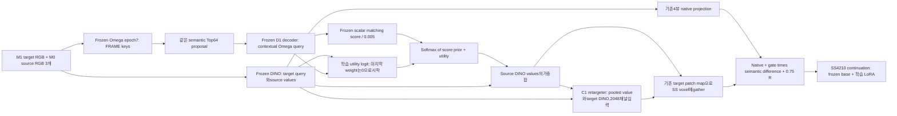

# Frozen matcher와 utility attention 후속 실험

## 첫8개 구조의 실제 고정 결과

동일 DeformNeXt128개·93source·3개 생성 noise,각480update/5epoch의 결과다. V1은 IoU43.2650%,matched Top1+C1은44.2757%,기존 C1 T0.005는44.2193%,static-C1 T0.05는44.0938%,learned Full은43.9236%,native-spatial은44.1701%였다. 실제 `candidate-selection-v1.json`은 `NO_PROMISING_COMBINATION_YET`이며6개 Top-K 후보 모두 같은 retargeter의 Top1 대조 기준을 통과하지 못했다. 모델을 채택하지 않는다.

Static-C1−Top1+C1은 −0.182pp,95% source-cluster CI[−0.308,−0.079]pp,Full−Top1+C1은 −0.352pp,[−0.624,−0.127]pp였다. 기존 C1−Top1+C1은 −0.056pp,[−0.131,+0.007]pp로 추가 이득이 확인되지 않았다. Retargeter를 더한 Top1+C1−Top1은 +0.823pp,[+0.427,+1.222]pp였다. 이 결과는 retargeter가 없는 Top1을 대조군으로 쓰면 Top-K의 효과를 잘못 읽을 수 있음을 보여준다. 모든 CI는 한 training seed에 조건부인 탐색 결과다.

실제 고정128의 feature 진단에서는 decoder/score 공동 학습으로 prior 실효K가4.67에서10.66으로 늘고,argmax가45.32% query에서 바뀌었다. 이는 정확도 하락의 증거나 SS 성능 차이의 확정 원인이 아니다. Frozen R9의 정보와 초기 가중합을 유지한 상태에서 생성용 utility만 학습하는 분리가 아직 검증되지 않았으므로,다음 단일 모델로 이를 검사한다. 첫 round의 보고서·선정 결과·모델·평가를 덮어쓰거나 기준을 완화하지 않는다.

## 후속 모델 F1

Frozen Omega epoch7과R9 D1 decoder/scalar head를 유지한다. 같은 semantic64 후보에서 `frozen_score/0.005 + utility_logit`으로 가중치를 구한다. Utility query는 native target DINO와 frozen contextual Omega, key/value는 원래 source DINO다. Query/key의128차원 projection으로 만든 elementwise product·절대차256차원에서 작은 scalar logit을 예측하며,마지막 linear weight를0으로 초기화한다. 초기에는 frozen matching prior만 읽고,SS 생성 loss로 utility output과 이어지는 query/key projection을 학습한다. Candidate value 자체를 바꾸는 projection은 추가하지 않는다.

C1 retargeter·fusion gate·denoiser LoRA는 같은 조건으로 학습한다. Deformation-query channel은 물리적으로 없고 retargeter 입력은2048차원이다. 기존 task 설정의`decoder`/`score_prior`는 forward 경로 존재 여부로 유지하고,새`train_decoder=false`/`train_score=false`가 학습 여부를 명시한다. 이전 Full·No-decoder·No-prior의 기본 동작과 checkpoint key는 그대로 유지한다.

현재 F1의 데이터 흐름은 아래와 같다. 구현된 후보 구조이며 최종 full model로 선정한 것은 아니다. Decoder/score는 frozen 상태로 forward에 참여하고,utility와C1 retargeter·fusion gate·SS LoRA가 학습된다.

사용자 SS4210에서 fresh seed101,global96/DDP2/micro48/accumulation1,5epoch/480update로 시작한다. 기존 native LoRA continuation·데이터·optimizer/LR·warmup25·validation32/12steps/CFG3·final128×3/생성batch8 조건을 유지한다. 기존 DeformNeXt world-v4 train9149/validation508과 RGB/Omega/DINO/proposal/projection cache를 재사용하며 새 raw/depth/matching 데이터 구축은 없다. GPU2/3의 이미 실행 중인 No-retargeter Top1 seed202는 유지하고 F1은 GPU0/1을 사용한다.

초기 native condition의 exact equality,실제 SS loss의 LoRA·fusion·retargeter gradient,temporary restored probe의 utility gradient와 matching decoder/score gradient0을 검사한다. DDP 두 update memory probe에서 micro48/accumulation1·각rank batch/유한 loss를 확인하고 benchmark optimizer를 재사용하지 않는다. 예상 optimizer state는371개(LoRA360+C1의6+utility5)이며 실제 값과 frozen matcher24개 tensor를 따로 검사한다. 매epoch validation/W&B 수치·그림,실제 raw checkpoint·optimizer·file4 대조를 유지한다.

## 판정과 후속 범위

원래 raw480/fixed128×3에서 V1과 같은 retargeter의 Top1 대비 paired source-cluster CI가 양수이고3noise 모두 같은 개선 방향이어야 개선 후보로 인정한다. 기존 C1 및 No-retargeter Top1 대비 결과도 함께 보고한다. Best epoch를 고르거나 initial/native equality 및 gradient 통과를 품질 개선으로 간주하지 않는다.

F1이 통과하면 fresh seed202 F1과 matched Top1+C1 seed202를 병렬 학습해 Top-K utility의 추가 효과도 두 optimization seed에서 검증한다. 이미 진행 중인 No-retargeter Top1 seed202는 전체 조합의 추가 기준선으로 재사용한다. 그 뒤 원래 예약한source-disjoint additional121/39source에서 고정 모델과 기준선을 비교하며,이 validation panel을 독립 미사용 test라고 부르거나 결과로 후보를 다시 고르지 않는다. 현재는 CPU 경로 검사61개를 통과한 구현 단계이며,실제 GPU 정합·memory proof·F1 본 학습·성능 향상은 아직 완료되지 않았다.

## 실제 시작 검사: 2026-10-19 UTC

위 구현 시점 이후 실제 GPU 정합·DDP memory proof를 통과했다. 실제 sample의 초기 global/projection condition은 native와 exact equality였고,LoRA/fusion/retargeter gradient는 양수,decoder/score gradient는0이었다. 원상복원하는 임시 probe에서 utility gradient도 확인했다. 실제2update DDP에서 두 rank 모두 micro48/global96/accumulation1·유한 loss를 확인했고,최대 allocated memory는50.464/50.336GiB,두 번째 update 계산 시간은17.263/17.295초였다. 이는 본 학습 전체의 OOM 보장이 아니다.

2update saved conditioner의24개 decoder/score tensor가 실제 R9 initializer와 정확히 같았다. Adam state371개가 모두 step2·유한 moment였고,zero-initialized utility output의256개 weight가 모두 갱신됐다(L2 norm 약1.321e-5). Retargeter 입력도2048채널로 확인했다. 이 benchmark optimizer는 본 학습에 재사용하지 않았다. 본 학습은 원래 SS4210에서 새로 시작해 초기 validation을 수행 중이며,이 기록 시점에는 본 SGD나 품질 개선을 완료했다고 주장하지 않는다.

첫 launch에서는 생성한 실행 recipe의 `ckpt`/`load_dir`가 JSON null이어서 memory benchmark가 optimizer update 전에 종료됐다. 실패 config·native proof·launch log·queue 상태를 `launch-attempts/attempt01-null-resume-option/`에 보존했다. 기존 runtime이 요구하는 `ckpt="none"`, `load_dir=""` 문자열로 수정하고 해당5개 job만 재개했다. 이미 학습 중인 Top1 seed202 process는 유지했고,scheduler만 정상 종료·재개해 동일 PID의 학습을 이어갔다. 잘못된 fresh 옵션을 모델 로딩 전에 거부하는 검사도 추가했다.

`summarize_frozen_utility_followup.py`는5epoch·실제 W&B 그림/수치·file4 audit bytes·saved tensor/optimizer·GPU conditioning 검사와 fixed raw480/128×3을 모두 확인한 후 V1/같은 retargeter Top1/retargeter 없는 Top1을 비교한다. 판정 결과가 양수여도 모델 채택은false이며 추가 seed/121개 검증이 필요하다. 새로운 실패 거부 검사11개가 통과했다. 이11개 unit test는 실제 모델 품질 근거로 사용하지 않는다.

00:15 UTC에는 본 학습 두 rank가 실제3update를 완료했다. 초기 validation32에서 V1·기존 C1·matched Top1+C1의 초기32개와 각 asset의 GT voxel hash·noise·source ID·TP/FP/FN 및 네 aggregate metric이 모두 같았다(IoU0.42671546671444294). 본 학습의 첫 update는 data-worker 시작으로 약43초 loading과83~85초 compute,두 번째는39.3초,세 번째는17.28~17.29초 compute였다. Benchmark 수치를 그대로 본 학습 속도라고 부르지 않고 실제 startup과 이후 구간을 구분한다. 이 시점 peak allocated memory는 두 rank50.464/50.510GiB이고 OOM·비정상 loss는 관측되지 않았다. 전체480update 품질 판정은 아직 남아 있다.

추가 seed의 matched Top1+C1 대조군은 F1의 결과를 기다리기 전에 예약했다. 현재 GPU2/3에서 진행 중인 No-retargeter Top1 seed202의3개 최종 noise 평가와 saved-weight QA가 끝난 뒤,같은 GPU2/3에서 fresh SS4210/seed202/global96/micro48/DDP2/480update로 시작한다. 원래 최고 대조군의 재현성을 검사하는 목적도 있어 F1이 음성이어도 유효하다. F1을 미리 선정하거나 학습 중인 run을 바꾸지 않았다. F1이 통과하면 그 seed202 학습은 나머지 GPU에서 병행하고 이 대조 결과를 재사용한다.

## 첫 학습 경로 확인: 00:29 UTC

F1 두 rank가51update를 완료했다. 실제 SS loss의 utility-attention gradient L1은 두 rank 모두0.0005894062601345951,decoder/score gradient는 모두0이었다. Fusion gate는0.003604,retarget residual RMS는 약0.00657/0.00679였다. 초기 step1의 utility gradient0 이후 실제 학습 신호가 흐르는 것을 확인한 것이며,품질 기여로 해석하지 않는다. 현재 batch의 effectiveK는1.228/1.212로 frozen T0.005의 강한 prior를 유지하는 구간이다. 서로 다른 batch의 수치를 직접 학습 전후 분포 변화로 해석하지 않는다.

No-retargeter Top1 seed202는 첫 epoch의 실제 W&B 네 수치·PNG 및 optimizer361개·raw checkpoint/file4 대조를 통과했다. Common32/한 noise의 IoU는0.435216로 seed101의 같은 epoch0.435134와 비슷했다. 두 run 차이는+0.008pp,source-cluster CI[−0.212,+0.255]pp였다. 이 CI는 두 고정 run의 source-panel 차이에 대한 것이며 training-seed 모집단의 불확실성을 추정하지 않는다. 추가 seed의 최종5epoch 결과와 F1 첫 epoch·최종128×3 품질 판정은 남아 있다.

## 실제 F1 첫 에폭

F1의 첫96update·validation·실제 W&B 네 수치와PNG·optimizer371개 및 raw checkpoint/file4 대조가 통과했다. Saved conditioner의24개 decoder/score tensor는 초기 R9와 정확히 같았고,utility의5개 parameter는 모두 갱신됐다. Output weight의 L2 변화는0.015699,query/context/key projection은 각각0.019743/0.029429/0.037850이었다. 원래 native 시작 출력이 같은 상태에서 새 utility가 실제로 학습된 근거이며,그 품질 기여는 별도 비교가 필요하다.

| 같은32개·noise0 | IoU |
| --- | ---: |
| Zero source4M0 | 0.394997 |
| Zero edited1M1+source3M0 | 0.426715 |
| V1,epoch1 | 0.432148 |
| 기존 frozen C1 T0.005,epoch1 | 0.436335 |
| Matched Top1+C1,epoch1 | 0.437187 |
| Joint-trained Full,epoch1 | 0.438333 |
| 새 F1,epoch1 | 0.436888 |

F1−matched Top1+C1은 −0.030pp,95% source-cluster CI[−0.154,+0.072]pp였다. 기존 C1 대비 +0.055pp,[−0.018,+0.132]pp,V1 대비 +0.474pp,[−0.533,+1.372]pp,Joint-trained Full 대비 −0.144pp,[−0.332,+0.010]pp였다. 네 대조 모두0을 포함했다. Zero edited RGB 대비 +1.017pp,[−0.597,+2.569]pp,source4M0 대비 +4.189pp,[+1.120,+7.587]pp였다. 모두 common32·단일 sampling noise·고정 training seed101의 중간 비교다. 첫 에폭 결과로 모델을 채택하거나 중단하지 않고 raw480/fixed128×3 기준을 유지한다.

최종 보고서에도 두 zero-shot의 기존128×3 실제 평가를 재사용한다. Source-only는4M0 RGB,edited-RGB는1M1+3M0 RGB이며 둘 다 같은 M1 GT에 대해 평가한다. 실제 기존 Top1+C1의 zero-shot 대비 세 noise paired 결과를 그대로 재현하는 reporting preflight가 통과했다. 이를 새 F1의 최종 성능 결과로 혼동하지 않는다.

학습 후에는 동일 raw480 모델의 common32/noise0에서 score·attention weight·candidate support와 각 query의 source-value multiset을 유지하고,value-to-weight pairing만 바꾸는 진단을 추가한다. 이는 원래 spatial matching을 사용하는 사용자 No-corr 학습 arm과 구분한다. 새 residual-zero utility의 초기 및 nonzero output 상태에서 logits·weights·입력 보존,pooled value 변경,hook 원상복원 검사2개가 통과했다. 이 진단은 모델 품질 선정이나 semantic retrieval 전체의 필요성을 단독 판정하는 기준이 아니다.

## 첫 에폭의 실제 optimizer 정규화

실제 misc step96의 conditioner Adam group은 LR1e-4,betas(0.9,0.95),eps1e-8이었다. `BasicTrainer`가 trainable `model.parameters()` 순서로 group을 만드는 것을 확인하고,같은 constructor의11개 trainable parameter와 저장된 optimizer state의 shape를 모두 대조했다. 아래 RMS는 raw gradient 한 번의 값이 아니라 bias-corrected second moment의 제곱근이다.

| Parameter | Median gradient RMS | eps보다 작은 성분 | Median RMS/(RMS+eps) |
| --- | ---: | ---: | ---: |
| Utility query projection | 7.15e-10 | 99.60% | 0.0667 |
| Utility Omega-context projection | 1.41e-9 | 99.46% | 0.1237 |
| Utility key projection | 2.14e-9 | 98.87% | 0.1764 |
| Utility output weight | 2.20e-6 | 0% | 0.9955 |
| Retargeter first weight | 6.42e-7 | 0.068% | 0.9847 |

즉 현재 query/key projection은 gradient 연결과 FP32 parameter 변화가 있으면서도 Adam 분모의 epsilon으로 업데이트가 크게 줄어드는 구간이다. 출력 head와 retargeter에는 같은 정도의 감쇠가 없다. 마지막 열은 현재 moment를 고정한 채 epsilon이 없는 분모와 비교한 산술 계수이며,다른 epsilon으로 재학습한 결과를 뜻하지 않는다. 이를 성능 부진의 확정 원인이나 epsilon 변경의 개선 증거로 해석하지 않는다.

현재 학습을 변경하지 않고 후반 checkpoint의 moment·utility 변화·실제 품질을 확인한다. 최종 성능이 부족하고 이 감쇠가 지속된다면,utility만 별도 Adam epsilon을 사용하는 통제 실험을 검토할 수 있다. LoRA와 retargeter까지 함께 바꾸는 실험으로 utility 학습의 효과를 혼동하지 않도록 한다. 같은 target patch의 voxel 공유와 native context 차이 진단도 별도의 설계 가설로 유지한다.

재사용 가능한 `inspect_utility_optimizer.py`로 실제 step96을 재검사해11개 parameter 통계를 기존 진단과 재현했다. 이 inspector는 실제 config/misc와 group 구성 source의 SHA를 함께 기록하고,371개 optimizer state의 step·유한값 및11개 대응 shape를 확인한다. Step288과480의 실제 epoch/file4 대조가 완료되면 같은 방법으로 기록하도록 예약하며,학습 optimizer나 GPU에 변경을 가하지 않는다.
