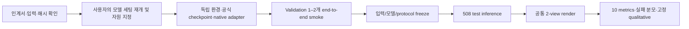

# DeformNeXt-10k baseline benchmark 에이전트 인계서

> 이 문서부터 읽는다. 2026-10-20 기준 데이터 경로·모델 선택·평가 설정·준비 상태·실행 순서를 통합했다.
> **현재 허용 범위는 모델 세팅 이전 준비까지다. 사용자는 모델 다운로드·설치·실제 모델 검증을 보류했다.**
> 이 문서를 전달받았다는 사실만으로 모델 다운로드나 GPU 작업을 시작하지 않는다. 후속 지시에서 보류가 해제되고 사용할 node/physical GPU가 지정되면 아래 실행 단계를 진행한다.

## 0. 한눈에 보는 상태

| 항목 | 상태 |
|---|---|
| 508 test / 146 source UID / 134 source cluster / 42 category | metadata 및 입력 준비 |
| Source/target RGB·raw mesh·GT material dump | 필요한 3,702파일 hash inventory 작성 |
| M0 canonical textured mesh | **146 UID canonical.glb 전부 metadata SHA256 일치**, metadata 포함 292파일 추가 |
| 모델용 입력 목록 | **inference-inputs-with-meshes.jsonl, 508줄** 사용 |
| GT renderer job | 1,016개 계획, 실제 render 미실행 |
| 재사용 evaluator | 코드 작성, CPU synthetic 20 tests PASS |
| LPIPS/DreamSim/CLIP/Inception actual weight 로딩 | 이번 신규 패키지에서는 미검증/보류 |
| 공통 Blender 실제 실행 | 미검증/보류 |
| 8개 baseline clone/install/download/smoke/inference | 미실행/보류 |
| 실행 node/GPU | **새 benchmark에 배정된 자원 없음** |
| 설계 선택 | 입력 구성·공통 복원기·SpaceControl control 모두 사용자 확정; 실제 setup/검증은 보류 |

**준비 완료의 의미:** software·data index·data integrity·실험 계약 초안까지다. 실제 모델/renderer 동작 확인까지 완료되었다고 보고하지 않는다.




### 2026-10-20 입력/복원기/control 계약 v3 — 사용자 채택

최신 계획은 `PREP/model-plan-v3.json` 및 저장소 `deformnext_benchmark/configs/baselines-v3.json`이다. 이전 model-plan v1/v2와 baselines v1/v2 및 software-v1 archive는 보존했다. 새 설정 JSON을 software archive와 함께 전달한다. Artifact 인계 문서 사본은 `AGENT_HANDOFF_KO-v3.md`, 최신 색인은 `handoff-index-v3.json`이다. 모델 다운로드/설치/실행 보류는 유지한다.

사용자가 공통 ReconViaGen v0.5 복원기와 TRELLIS.2 target-proxy + M0 anchor appearance SpaceControl 구성을 채택했다. 선택지 비교는 `2026-10-20-baseline-reconstruction-control-options-ko.md`에 남겼다. 실제 모델 설치나 inference는 하지 않았다.

## 1. 코드·준비 산출물 절대 경로

### 코드

- 작업 worktree: `/root/dev/Pixal3D/.worktrees/anchor-hybrid-prestudy`
- 패키지: `/root/dev/Pixal3D/.worktrees/anchor-hybrid-prestudy/deformnext_benchmark`
- 사용법/API/schema: `/root/dev/Pixal3D/.worktrees/anchor-hybrid-prestudy/deformnext_benchmark/README.md`
- 설정:
  - `deformnext_benchmark/configs/baselines-v3.json`
  - `deformnext_benchmark/configs/protocol-v1.json`
  - `deformnext_benchmark/configs/local-metric-weights.template.json`
- Native model 개발 worktree는 별도인 `/root/dev/Pixal3D/.worktrees/ray-score-prior-stage-20261019`다. 그 안의 진행 중인 학습/큐/환경을 변경하지 않는다.

### 현재 사용할 준비 디렉터리

`/root/dev/pixal3d-inspection/baseline-benchmark-preparation-v3-20261020`

이하 `PREP`라 부른다. v1/v2는 중간 metadata preview이므로 새 실행의 authority로 쓰지 않는다.

| PREP 아래 파일 | 목적 |
|---|---|
| **inference-inputs-with-meshes.jsonl** | 모델용 508개 입력; canonical M0 GLB 경로까지 연결한 최신 목록 |
| inference-inputs.jsonl | 최초 metadata-only 목록; textured_source_mesh=null이므로 위 보완본을 우선 |
| source-meshes.jsonl | 146 UID의 canonical GLB/metadata/path/hash/원본 provenance |
| references.jsonl | evaluator-only M1 raw V/F 및 camera/reference-render 경로 |
| GT-render-jobs.jsonl | trusted M1 material dump로 GT 렌더링할 1,016개 job |
| protocol.json / **model-plan-v3.json** | 평가 권장안 및 최신 모델·입력 선택 snapshot; model-plan.json은 이전 버전 |
| input-files-sha256.json | 첫 3,702파일 / 1,153,423,072 byte |
| source-mesh-files-sha256.json | source GLB/metadata 292파일 / 294,048,323 byte |
| qualitative-panel.json | 서로 다른 UID/category 12개, 결과를 보기 전 고정 |
| gallery.html | 이미지 내장 입력 미리보기; 아직 baseline 결과 아님 |
| preparation.json | source manifest/protocol/코드 지문 및 최초 경로 검사 |
| software-verification.json | CPU 20 tests/컴파일/source archive hash 및 보류 범위 |
| deformnext-benchmark-software-v1.tar.gz | 코드/config/README/test 17파일, 모델·데이터 미포함 |

**보완본 주의:** `preparation.json`과 초기 README의 “textured M0 export deferred”는 최초 상태다. 이후 기존 `canonical.glb` 146개를 찾아 hash 검증하고 `inference-inputs-with-meshes.jsonl`로 연결했다. 새 export는 하지 않았다. 초기 snapshot을 수정하지 않고 보완 파일로 남겼다.

### Hash authority

- RGB test 원본 manifest SHA256: `ed5b6a5859d3f8e1f69dfc8635a081c4e40e3fd13ab928c78839ada0167514b6`
- 권장 protocol canonical-JSON hash: `5abddf2ff8a51af360e39a1ff7f5dda61d3b54269afa846b3fd14713a6e0fbb1`
- Software tar.gz SHA256: `df498a67d734dc8317421b110233dbbd4549f51cf169725b34759b9233ae257f`
- Tar.gz 크기: 30,678 byte.

Protocol hash는 `canonical_hash(json_object)`이며 포맷된 JSON 파일 자체의 byte SHA256과 다르다. `io.py`의 함수를 사용한다.

## 2. 데이터 authority와 경로 매핑

### 원본 dataset/split (File4 namespace)

- 최종 승인 dataset: `/file4/youngwoo/deformation/exports/pixal3d-final-approved-10165-20261012`
- Dataset pointer: `/file4/youngwoo/deformation/exports/training-dataset-current.json`
- Frozen split index: `/file4/youngwoo/deformation/exports/pixal3d-split-90-5-5-v1`
- Split pointer: `/file4/youngwoo/deformation/exports/training-dataset-splits-current.json`
- 전체 dataset: 10,165 deformations. Train/validation/test=9,149/508/508.
- Logical split은 index/manifest authority다. 파일 경로에 `/train/`이 들어 있다고 test를 제외하지 않는다. 과거 physical bundle을 재사용한 구조다.

### 로컬 cache / 실제 RGB test manifest

- `/file4/...`의 로컬 매핑 root: `/root/dev/.cache/deformnext-file4/file4`
- 즉 `/file4/youngwoo/...` → `/root/dev/.cache/deformnext-file4/file4/youngwoo/...`.
- `PREP/data`는 위 cache root를 가리키는 **로컬 symlink**다.
- 현재 test manifest:
  `/root/dev/.cache/deformnext-file4/file4/youngwoo/deformation/experiments/retargeting-v1/rgb_matching_v2/semantic-topk-search-v1/ray-group-study-v1/anchor-ray-composition-v1/feature-readout-v1/test508-preparation-v2/rgb_v1/manifests_world_v4_pending/test.jsonl`
- Validation manifest:
  `/root/dev/.cache/deformnext-file4/file4/youngwoo/deformation/experiments/retargeting-v1/rgb_v1/manifests_world_v4/validation.jsonl`
- Train manifest:
  `/root/dev/.cache/deformnext-file4/file4/youngwoo/deformation/experiments/retargeting-v1/rgb_v1/manifests_world_v4/train.jsonl`

RGB test의 `pending`은 native latent/cache 전체 전처리가 끝나지 않았다는 뜻이다. 508 RGB/geometry 입력이 없다는 뜻이 아니다. Legacy `/retargeting-v1/manifests/test.jsonl`은 depth-anchor schema이므로 현재 RGB benchmark에 그대로 쓰지 않는다.

Test의 world-v4 Shape1024/PBR latent는 준비 시점 각각 1/508이었다. 외부 RGB/mesh baseline에는 GT target latent를 입력하지 않으므로 이를 전부 다시 encoding할 필요가 없다. Ours의 latent-dependent 경로를 평가할 때는 별도 완료가 필요하다.

### M0/M1 데이터 의미

- 모델 입력: source M0 RGB(9/10/11), M0 anchor RGB(8), edit M1 RGB(8), 저장 camera 및 필요한 경우 canonical **M0** mesh.
- Source mesh는 `inference-inputs-with-meshes.jsonl`의 `textured_source_mesh`를 사용한다.
- M1 GT raw surface는 `references.jsonl`의 `mesh` 경로다. NPZ는 `V/F` 키다.
- Model output은 `vertices/faces` NPZ 또는 원본 native GLB/OBJ를 evaluator가 읽을 수 있다.
- GT material dump는 job의 `trusted_material_dump`; 익숙하지 않은 외부 pickle을 역직렬화하지 않는다.
- Model subprocess에는 evaluator-only M1 geometry/hidden M1 renders/GT latent/GT correspondence를 제공하지 않는다.

## 3. 다른 노드로 전달하는 방법

로컬 `/root/dev` 절대 경로가 다른 노드에도 있다고 가정하지 않는다. Node17 호스트의 bind mount와 컨테이너 경로도 구분한다. 이 문서의 `/root/dev` 경로는 준비를 만든 **현재 컨테이너 namespace** 기준이다.

1. Software tar와 PREP의 작은 JSON/JSONL/HTML 파일을 전달한다.
2. 두 SHA inventory에 나온 파일만 `data/` 아래 상대 경로 그대로 전달한다. 총 3,994 inventory entries / 약1.45GB이며 1.3TB 전체 cache 복사는 불필요하다.
3. `data` symlink 자체를 복사해서 전달 완료라고 하지 않는다. 새 staging에는 **실제 directory**를 만든다.
4. Dataset의 일부 geometry가 symlink이므로 원본을 copy할 때 명시적으로 dereference한다.
5. 전달한 파일 SHA256/byte 수를 두 inventory와 대조한다. Source canonical GLB는 canonical.json의 선언 hash와도 일치했다.

복사 목록 생성 예시(데이터 복사만이며 모델 다운로드가 아님):

```bash
BENCHMARK_PREP=/root/dev/pixal3d-inspection/baseline-benchmark-preparation-v3-20261020
python3 - "$BENCHMARK_PREP" /tmp/deformnext-benchmark-copylist.txt <<'COPYLIST'
import json,sys
from pathlib import Path
root=Path(sys.argv[1]); paths=set()
for name in ['input-files-sha256.json','source-mesh-files-sha256.json']:
    for item in json.loads((root/name).read_text())['per_file']:
        assert item['path'].startswith('data/')
        paths.add(item['path'][5:])
Path(sys.argv[2]).write_text('\n'.join(sorted(paths))+'\n')
COPYLIST
```

사용자가 정한 **새 비어 있는 staging**에 metadata를 복사한 다음:

```bash
# BENCHMARK_STAGE와 BENCHMARK_CACHE를 실제 전달 경로로 지정한 뒤 실행한다.
# BENCHMARK_STAGE/data가 이전 cache symlink이면 여기로 rsync하면 안 된다.
test ! -L "$BENCHMARK_STAGE/data"
mkdir -p "$BENCHMARK_STAGE/data"
rsync -a --copy-links --files-from=/tmp/deformnext-benchmark-copylist.txt \
  "$BENCHMARK_CACHE/" "$BENCHMARK_STAGE/data/"
```

각 예제의 미지정 변수를 빈 문자열 상태로 실행하지 않는다. 원격 protocol/reference-root/prediction-root는 실제 staging/output root로 설정한다. 평가 경로들은 root 상대경로이므로 metadata의 `/root/dev` 전체 치환은 필요 없다.

## 4. 모델 선택과 남은 결정

| ID | 공식 저장소 / 선택 | 입력/출력 관련 주의 |
|---|---|---|
| trellis2 | https://github.com/microsoft/TRELLIS.2 main | **target1-view만**, camera8 M1 RGB; M0/source 입력 없음 |
| pixal3d | https://github.com/TencentARC/Pixal3D **main** | **target1-view만**, camera8 M1 RGB; M0/source 입력 없음 |
| reconviagen | https://github.com/GAP-LAB-CUHK-SZ/ReconViaGen **v0.5** | **target1-view + source3-views**, 순서 [M1@8,M0@9,M0@10,M0@11]; source anchor8 추가 금지 |
| mvadapter | https://github.com/huanngzh/MV-Adapter image-conditioned SDXL | native multi-view 이미지 출력; geometry metric에는 추가 복원기 필요 |
| corradapter | https://github.com/SuhZhang/CorrAdapter MVAdapter integration | MVAdapter+CorrAdapter를 기본으로 계획; trained CorrAdapter*와 구분 |
| geostyle | https://github.com/changwoonchoi/GeoStyle master **official vanilla** | production PA/JN-L/ISIR를 추가하지 않음 |
| shapeup | https://github.com/inbar-2344/ShapeUp / HF Inbar2344/ShapeUP | geometry와 texture checkpoint 모두 공개 확인; model card 옛 문구보다 실제 files 확인 |
| spacecontrol | https://github.com/spacecontrol3d/spacecontrol | TRELLIS.2 target-proxy mesh control + M0 anchor8 appearance |

실제 clone/download 시 공식 commit, weight revision/SHA, model config/steps/guidance/resolution, 환경 lock과 native output 형식을 기록한다. `main`/`v0.5`는 mutable branch name이다. 현재 commit 필드 null은 미설치 상태의 의도적 표시다.

### 확정한 입력·공통 복원기·SpaceControl control

1. **TRELLIS.2/Pixal3D:** target_input_rgb 한 장만 사용한다. M0/source 입력 없음.
2. **직접 ReconViaGen v0.5:** `[target_input_rgb, source_images[0], source_images[1], source_images[2]]`, 즉 `[M1@8,M0@9,M0@10,M0@11]`. Source anchor8을 추가하거나 source를 hidden M1 view로 바꾸지 않는다.
3. **MVAdapter/CorrAdapter:** target 한 장에서 각각 생성한 target multi-view들을 **같은 ReconViaGen v0.5 checkpoint/config**로 복원한다. M0 source3장을 복원기에 추가하지 않는다. 직접 ReconViaGen baseline의 네 장 입력과 구분한다. 표 이름은 `MVAdapter + ReconViaGen-v0.5`, `MVAdapter+CorrAdapter + ReconViaGen-v0.5`다.
4. **SpaceControl:** 같은 sample/seed0의 TRELLIS.2 target1-view baseline이 만든 **raw predicted mesh**를 spatial control로 재사용한다. Appearance는 `source_anchor_rgb` **M0@8 한 장**, text는 source category의 `a {category}`. GT M1 mesh/occupancy/fitted GT primitives를 넣지 않는다. 표 이름은 `TRELLIS.2 target-proxy + SpaceControl`이다.

Conceptual 입력/backend 선택은 모두 확정됐다. Native adapter·camera/projection 호환성·좌표 inverse·공식 default/control strength pinning은 실제 setup/Validation smoke에서 확인한다. Test 점수에 맞춰 source/image/backend를 교체하지 않는다. SpaceControl proxy는 render용 decimation 전 원본 예측 geometry를 사용한다. Proxy 생성 전체 비용, SpaceControl 추가 비용, 합성 pipeline 전체 비용과 캐시 재사용 wall-clock을 분리한다.

GeoStyle 배포 LoRA는 논문 예제용이다. Test edit의 generic pretrained LoRA가 아니다. 필요한 test-time LoRA/approx-encoder fitting은 공식 vanilla 절차와 같은 설정으로 수행하고 비용을 분리한다. Dataset GT 생성 당시 donor LoRA/raw proposal/최종 M1 optimization state를 baseline 출력으로 재활용하지 않는다.

## 5. 공통 좌표·렌더링 설정

현재 `PREP/protocol.json`은 **권장 v1**이다. 실행 전 Validation smoke로 동작을 확인하고 freeze한다. 변경하면 새 protocol/hash와 새 결과 namespace를 만든다.

- 기존 `frame_extent=.48` representation 계약 유지.
- 평가 좌표는 저장된 source-defined Blender render world. Raw canonical M0/M1 V/F는 여기에 있다.
- M1별 또는 prediction별 bbox normalization, GT를 향한 ICP/scale fitting 금지.
- Material dump에 기존 normalization이 있으면 job의 archived extent/center로 world를 복원한다. 이것은 prediction alignment가 아니다.
- Prediction의 `to_world`는 native export 규약 또는 source-only calibration에서 결정하고 provenance를 기록한다.
- GLB Y-up→Blender Z-up 변환을 geometry reader와 renderer에 동일하게 적용한다. OBJ/NPZ는 raw Blender/world 축이다. `to_world`는 이 형식 변환 이후 좌표에 적용된다.
- Camera: 저장된 Blender/OpenGL camera-to-world와 FOV. Target RGB input8; 주 평가 **9/10 두 view**, input-view 점수와 섞지 않는다.
- Blender **4.2.3**, Cycles, **512×512**, **64 samples**, fixed seed20261020.
- Denoising/adaptive sampling off. 동일 3 area lights/world strength.
- Standard/None, exposure0, gamma1. RGBA PNG를 white background에 합성.
- 모델의 생성 material/UV를 유지한다. GT만 original-material M1이다. Prediction texture를 원본 texture로 덮어쓰지 않는다.
- GT와 prediction을 **같은 renderer**로 새로 그린다. 기존 다른 조명의 target RGB를 새 prediction render와 PSNR 비교하지 않는다.
- 약1M face render-only decimation 정책은 모든 모델/GT에 동일하게 적용한다. 원본 prediction과 surface metric은 그대로 유지한다.
- 24-view rendering은 요구하지 않는다.

## 6. 10 metrics와 집계

| 축 | Metrics | 참조/정의 |
|---|---|---|
| Source appearance preservation proxy | LPIPS↓, DreamSim↓, CLIP↑ | 원래 재질이 유지된 **M1** GT; M0 pixel 직접 비교 아님 |
| Overall render distribution | FID↓, KID↓ | 동일한 M1 GT render population, TF-compatible Inception pool2048 |
| Target alignment | PSNR↑, SSIM↑, M-IoU↑ | 동일 camera/render/background의 M1 |
| Target geometry | CD↓, F-Score↑ | 같은 world 좌표의 M1 raw surface |

구현 세부:

- LPIPS: official v0.1 VGG backbone+calibration 둘 다 필요.
- DreamSim: official trained ensemble; separate original OpenAI CLIP ViT-B/16을 CLIP cosine에 사용.
- PSNR: MSE floor1e-12, exact match120dB cap. SSIM: native Gaussian11/sigma1.5/population/zero-padding/RGB mean. Mask alpha>.5.
- Surface: area-weighted20K/mesh, deterministic independent draws. CD=양방향 unsquared L2 평균의1/2. Squared L2는 보조 출력. F threshold=.02 world units.
- FID: float64 covariance/PSD solve, singular covariance 허용.
- KID: unbiased degree3 polynomial MMD, subset100×100 repeats, seed20261020, 원래 scale. KID 음수는 clamp하지 않음. Subset std는 source population CI가 아님.
- 작은 상관 표본에서 FID/KID를 자연스러움의 직접 판정으로 부르지 않는다. 508 variants/146UID/134clusters를 함께 보고한다.
- View→seed/sample→deformation 평균, deformation-weighted/UID-weighted 모두 제공. CI resampling unit=source cluster, 기본4,000 draws.
- 실패율과 원래 분모를 남긴다. Success-only 평균은 조건부 평균으로 표시한다. Incomplete population의 FID/KID는 기본 미계산한다.
- GT 평가 geometry나 렌더를 generation input으로 전달하지 않는다. Model prediction의 M0와 V/F 일치를 요구하지 않는다.

## 7. Metric 환경/weight 준비는 후속 setup 단계

현재 패키지는 실제 모델 weight를 로드하지 않았다. CPU 20 synthetic tests는 numeric/plumbing 검증이다.

- Core deps: `deformnext_benchmark/requirements-core.txt`.
- Optional raw mesh reader: trimesh.
- Learned deps: torch/torchvision/lpips/dreamsim/open_clip_torch/torch-fidelity. 별도 환경에서 실제 버전을 고정한다.
- Weight registry template: `deformnext_benchmark/configs/local-metric-weights.template.json`.
- Template의 빈 `files`를 완전한 relative path/byte/SHA inventory로 채워야 하며 자동 다운로드 fallback은 차단된다.
- 기존 공식 DreamSim/CLIP cache는 아래에 있다. **새 registry schema와 그대로 호환되지는 않으므로** 경로/해시를 변환하고 필요한 VGG/Inception도 별도 확인한다:
  `/root/dev/.cache/deformnext-file4/file4/youngwoo/deformation/experiments/retargeting-v1/rgb_matching_v2/semantic-topk-search-v1/evaluation-models-v1`
- CPU/actual assigned GPU에서 identity pair, changed pair, official DreamSim forward, CLIP identity, official Inception dimension 및 FID/KID identity/distribution sanity를 확인한다. 실패를 숨기거나 random weights/다른 proxy로 대체하지 않는다.

## 8. 재개 허가 이후 실행 순서

1. 사용 node/physical GPU와 output/cache 경로를 확인한다. 기존 local 학습 job을 중단하지 않는다. 과거 node별 allow-list를 현재 benchmark 권한으로 사용하지 않는다.
2. 전달 데이터 해시를 검증하고 새 model/environment/config namespace를 만든다.
3. v3에 확정된 input/backend 계약을 native adapter에 구현한다. Generated target multi-view와 원본 source3장의 입력 경로를 혼동하지 않는다.
4. 공식 checkpoint를 내려받아 code/weight/config hash를 고정한다. DeformNeXt test로 fine-tune하지 않는다.
5. Validation1–2사례의 native generation→export→공통 render→metric을 확인한다. Test의 성능 수치를 보며 adapter/scale/guidance를 튜닝하지 않는다.
6. Common rendering에서 source/material/GLB축/상대 camera parity와 receipt를 확인한다. Native output transform을 GT에 fit하지 않는다.
7. Frozen test508에서 지정 seed0으로 실행. 각 method/sample/seed당 predictions JSONL 한 줄을 남긴다. 실패도 반드시 기록한다.
8. GT1,016 renders는 한 번 준비해 모든 모델이 재사용한다. 모델당 output508개, render1,016개다(8모델 최소4,064outputs).
9. Evaluator로 numeric+learned+distribution을 계산하고 CSV/CI/실패 taxonomy를 저장한다.
10. 고정12 UID 패널에 동일 camera 결과를 넣고 self-contained gallery를 갱신한다. Best-of sampling/예쁜 성공사례만으로 공통 패널을 교체하지 않는다.

### GPU 실행 규약

- 실제 지정된 GPU 하나에 single-GPU tool을 실행할 때 `CUDA_VISIBLE_DEVICES`와 `BENCHMARK_ASSIGNED_GPU`에 **같은 physical ID**를 넣는다.
- Tool 내부 device는 `cuda:0`이다. 과거 node17의0–3 규칙을 다른 노드에 자동 적용하지 않는다.
- 계정 정보/비밀번호는 이 문서에 저장하지 않았다. 접속 정보는 사용자의 별도 지시/안전한 기존 채널에서 받는다.
- 모델 이름·method/sample/seed·로그 경로를 process/작업명과 ledger에 남긴다. 재시도 및 timeout 정책도 Validation profiling 뒤 고정한다.

## 9. 실행 예제 (현재는 CPU 점검/문서 확인까지만)

### CPU 소프트웨어 체크

```bash
cd /root/dev/Pixal3D/.worktrees/anchor-hybrid-prestudy
PYTHONPATH=. CUDA_VISIBLE_DEVICES='' python3 -m pytest -q deformnext_benchmark/tests
python3 -m deformnext_benchmark --help
```

### 나중에 GT renderer 한 job

```bash
blender -b --python deformnext_benchmark/render_blender.py -- \
  --protocol "$BENCHMARK_PREP/protocol.json" \
  --jobs "$BENCHMARK_PREP/GT-render-jobs.jsonl" --job-index 0 \
  --root "$BENCHMARK_PREP" --device CPU
```

PNG 옆 `.receipt.json`이 함께 생성된다. GPU mode는 명시적인 할당/환경이 준비된 뒤 선택한다. Blender는 현재 script의 exact4.2.3을 요구한다. 타 버전으로 바꾸려면 protocol을 version하고 GT/모델 모두에 적용한다.

### 나중에 saved prediction 평가

```bash
python3 -m deformnext_benchmark evaluate \
  --references "$BENCHMARK_PREP/references.jsonl" \
  --predictions "$BENCHMARK_PREDICTIONS" \
  --protocol "$BENCHMARK_PREP/protocol.json" \
  --reference-root "$BENCHMARK_PREP" \
  --prediction-root "$BENCHMARK_OUTPUT_ROOT" \
  --output "$BENCHMARK_NEW_SCORE_ROOT" \
  --metric-registry "$BENCHMARK_LOCAL_METRIC_REGISTRY" --device cuda:0
```

Model-free numeric diagnostic만 필요하면 `--metric-registry ... --device ...` 대신 `--numeric-only`를 쓴다. 그 결과는 LPIPS/DreamSim/CLIP/FID/KID까지 계산한 full benchmark가 아니다.

성공 prediction schema는 package README에 있다. `views=[9,10]`, `mesh`, `to_world`, `frame_id`, `protocol_sha256`, camera/render receipts가 필요하다. Renderer는 GT/prediction에 같은 script를 사용한다. Raw metric mesh와 output PNG/hash/transform binding을 evaluator가 확인한다.

실패 prediction 예시:

```json
{"method":"pixal3d","sample_id":"...","seed":0,"status":"cuda_oom","reason":"..."}
```

실패에는 mesh/view가 없어도 된다. 누락된 prediction도 분모에서 빠지지 않는다. Full sample ID를 유지하고 UID만으로 덮어쓰지 않는다.

### 나중에 결과 gallery

```bash
python3 -m deformnext_benchmark gallery \
  --inputs "$BENCHMARK_PREP/inference-inputs-with-meshes.jsonl" \
  --references "$BENCHMARK_PREP/references.jsonl" \
  --panel "$BENCHMARK_PREP/qualitative-panel.json" \
  --methods "$BENCHMARK_PREP/model-plan-v3.json" \
  --reference-root "$BENCHMARK_PREP" \
  --predictions "$BENCHMARK_PREDICTIONS" \
  --prediction-root "$BENCHMARK_OUTPUT_ROOT" \
  --output "$BENCHMARK_NEW_GALLERY_HTML"
```

HTML에는 이미지를 base64로 내장한다. 외부 절대경로 이미지를 참조하는 gallery로 되돌리지 않는다. 현재 PREP/gallery.html은 M0/edit 입력24 이미지만 포함하며 모델 결과는 NOT RUN이다.

## 10. 최종 산출물·완료 조건

새 결과 root에 최소한 다음을 남긴다.

- run manifest: dataset/split/input hash, model code/checkpoint/config/env, input privilege, backend, 변환 근거.
- raw output mesh/material, predictions JSONL, sample별 runtime/failure ledger.
- 공통 RGBA render와 receipt, metric별 per-view/per-sample 값.
- summary.json, table.csv, deformation/UID weighting, cluster CI, category 분모.
- FID/KID feature cache와 extractor/input hash, population/image/UID/cluster 수.
- 고정 패널 qualitative HTML, 대표 실패 및 전체 실패율.
- 데이터/weight 준비, inference, mesh 복원, render, metric 시간을 분리한 runtime summary.

20개 CPU test는 실제 checkpoint/GPU/Blender 동작의 증명이 아니다. 실제 setup에서 문제를 발견하면 수정·검증하고 새 software/protocol 버전으로 기록한다. 기존 결과·승인 dataset·split·진행 중인 local 학습은 덮어쓰지 않는다.

**다음 에이전트의 첫 행동:** 이 문서와 package README를 읽고 최신 보류 해제/자원 지정을 확인한다. 보류가 해제되지 않았다면 download/setup/GPU 실행을 시작하지 않고, 준비 상태와 확정된 v3 구성, 아직 보류 중인 실제 setup/검증 단계를 설명한다.
