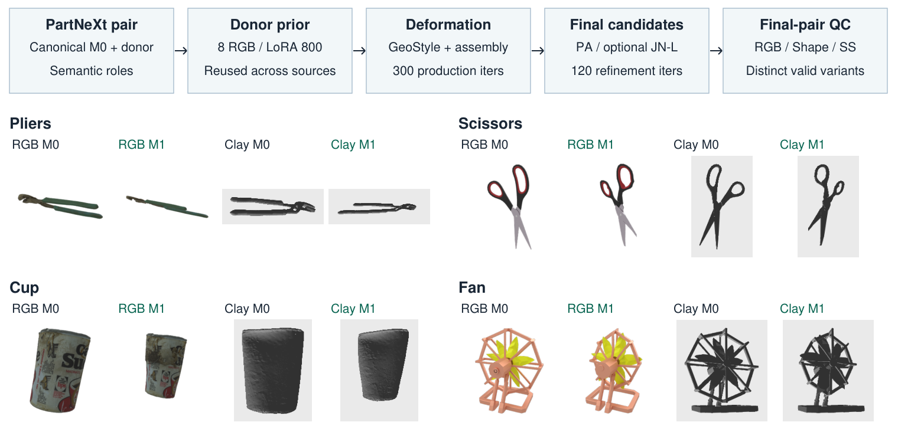

# GeoStyle 기반 DeformNeXt 구축 과정 원고 반영

작성: 2026-10-27T12:35:17.226880+00:00.

## 결과

사용자가 제공한 PDF를 읽고 실제 최종 데이터셋 기록·생산 코드와 대조해 영문 본문을 추가했다.

- 갱신 PDF: [2026-10-27-retargeting-final-manuscript.pdf](2026-10-27-retargeting-final-manuscript.pdf)
- 명시적 새 버전: [with-data-construction.pdf](2026-10-27-retargeting-final-manuscript-with-data-construction.pdf)
- 원본 보존: `/root/dev/pixal3d-inspection/manuscript-geostyle-data-20261027/original-manuscript.pdf` (21쪽)
- 새 원고: **24쪽**. PDF SHA256: `e91840d8b05d16a8d791259654f3628e678b5fea47c8f6df6e3c287815011acd`.
- 본문 **4.1 DeformNeXt-10k construction**: 4–5쪽. 데이터 구성 그림은 **Figure 5, 6쪽**.
- Supplement **A.1 DeformNeXt construction details and limitations**: 13–14쪽.

## 반영 내용

1. PartNeXt canonical V/F/order/UV/material/corner-attribute authority와 barycentric correspondence.
2. Semantic-role 기반 source/donor 선택, donor는 morphology prior이며 GT나 모델의 fine-tuning 입력이 아니라는 구분.
3. 8-view donor original RGB → SDXL DreamBooth LoRA 800 step/rank16 → source assembly-aware GeoStyle deformation.
4. Primary/follower/fixed 구성, source contact proxy, finite Poisson/rigid reconstruction의 범위.
5. 생산용 300 iteration/resolution512/batch1/cage83과 공식 기준 3600/resolution1024/batch4/cage1000의 차이. 두 설정의 동등성/수렴이 입증됐다는 주장은 하지 않는다.
6. 선택적 120-iteration balanced JN-L과 residual umbrella Laplacian의 실제 정의, 초기 gradient-norm 기반 가중치 고정.
7. M0→각 final M1의 독립 admission, 작은 intersection/gap/fold의 soft diagnostic 처리, 사람 검수/전체 collision-free 보장 아님.
8. 10,165 deformation /3,483 source UID /50 category, PA5611/JN-L4548/legacy6. 한 source의 추가 distinct variant 보존.
9. 9149/508/508 논리적 분할, UID/geometry-cluster disjoint, donor-disjoint 미강제·생성 후 split·장기 pretraining overlap 미감사 등 한계.
10. 실제 loader SS/Shape512 검증과 native VAE decode topology의 구분.

## 그림과 시각 검수

기존 large-edit presentation selection에서 Pliers/Scissors/Cup/Fan 네 category를 사용했다. 최종 snapshot membership을 확인한 기존 provenance에 포함된 사례이며, 전체 데이터 품질이나 수율의 random sample이 아니다. RGB camera8 및 clay camera14의 원본 PNG16개를 File4에서 가져와 보존된 SHA256과 대조했다. M0/M1에 공통 foreground-union crop을 적용했으며 개별 정규화·재색칠·새3D 렌더는 없다.

모든 24쪽을 렌더링하고 contact sheet와 신규 상세 페이지를 시각 검수했다. Fatal error, 미해결 인용/참조, overfull, page 밖 텍스트는 0이다. LaTeX underfull 메시지와 생성 figure PDF1.7을 output1.5에 포함한다는 version 경고는 로그에 남아 있다. 시각 검수에서 clipping/깨진 그림은 없었다.

## 동시 수정 보존

작업 중 기존 calibrated Pixal3D 행의 설명과 외부 baseline protocol 구분 문구가 다른 작업에서 갱신됐다. 이 최신 source를 유지하고 다시 빌드했다. 기존 TEST metric 여섯 행의 숫자 token은 원본과 정확히 같고, 기존 final-results 그림 19개도 bytes가 같다. 평가 모델을 실행하거나 기존 표 수치를 새로 계산하지 않았다.

## 소스와 재현

- [본문 소스](../paper/sections/data-construction.tex)
- [Supplement 소스](../paper/sections/data-construction-details.tex)
- [기존 실험 section 연결](../paper/sections/experiments.tex)
- [재현 가능한 그림 생성 코드](../paper/draw_deformnext_construction.py)
- 기존 GeoStyle 인용을 사용하고, PartNeXt의 NeurIPS2025 공식 저자·제목을 확인해 bibliography에 추가했다.

원본 TeX/PDF, 최신 source snapshot, figure provenance, 원본 PNG, 빌드 로그, 24쪽 검수 PNG/contact sheets, audit는 `/root/dev/pixal3d-inspection/manuscript-geostyle-data-20261027`에 보존했다. Generated assets는 Git source와 구분했다. Tectonic0.17.0의 기존 cache만 사용해 컴파일했으며 전역 패키지·GPU 작업·실험 설정을 바꾸지 않았다.

### 대조 근거

- `/root/dev/pixal3d-inspection/manuscript-geostyle-data-20261027/evidence/2026-10-12-geostyle-partnext-dataset-final-ko.md`
- `/root/dev/pixal3d-inspection/manuscript-geostyle-data-20261027/evidence/2026-10-12-dataset-train-validation-test-split-ko.md`
- `/root/dev/pixal3d-inspection/manuscript-geostyle-data-20261027/evidence/2026-10-04-10k-deformation-speed-priority-ko.md`
- `/root/dev/pixal3d-inspection/manuscript-geostyle-data-20261027/evidence/2026-10-04-lowmem-speed-results-ko.md`
- `/root/dev/pixal3d-inspection/manuscript-geostyle-data-20261027/evidence/2026-10-04-first-fast-approved-ko.md`
- [PartNeXt 공식 출판 정보](https://proceedings.nips.cc/paper_files/paper/2025/hash/579636b69390b41fa2d39b744593bfbe-Abstract-Datasets_and_Benchmarks_Track.html)
- [GeoStyle 공식 구현](https://github.com/changwoonchoi/GeoStyle)
